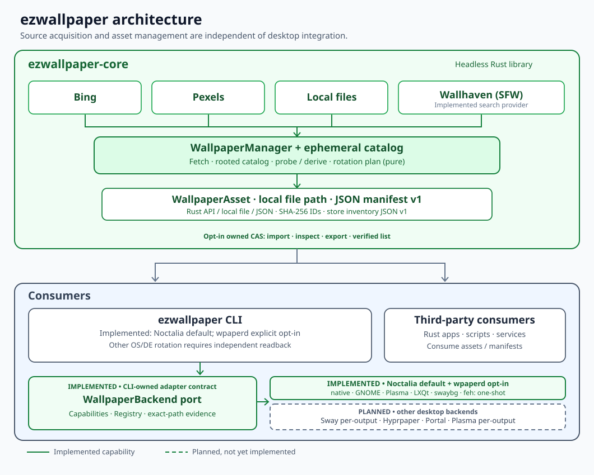

# ezwallpaper

A portable wallpaper acquisition and management library plus OS/DE-aware CLI. Existing cron and Windows Task Scheduler users can keep their flag-only workflows. See [ADR 0001](docs/adr/0001-core-cli-boundaries.md) for the accepted architecture.

## Architecture



The **headless `ezwallpaper-core`** acquires and exposes wallpaper assets, including a nonpersistent local catalog and JSON manifest v1. It can also compute optional, on-demand SHA-256 content IDs without altering JSON manifest v1; this allows external consumers to compare duplicate image bytes even if filenames differ. The **`ezwallpaper` CLI** consumes core assets and integrates with OS/DE/WM-native APIs or ecosystem programs; scripts and other applications can consume core assets without using a desktop setter. The **optional isolated Core-owned CAS** now provides explicit import, inspect and export. Dashed elements are **planned**, not implemented: additional sources, automatic cache GC, tagging and history.

**Architecture source of truth:** [editable SVG](docs/architecture.svg) · [implementation status](docs/architecture.md) · [accepted ADR 0001](docs/adr/0001-core-cli-boundaries.md) · [approved ADR 0003](docs/adr/0003-owned-content-store.md). Architecture-changing ADRs must update this diagram **in the same PR**, or document a specific reason why the decision has no impact on the diagram (see [ADR contribution rules](docs/adr/README.md)).

# Features
- support set desktop background with images from [bing daliy picture](https://www.bing.com)
- support set desktop background with images from local file system
- support set desktop background with images from [pexel](https://www.pexels.com/)

# Usage
Original manual use was reported on Windows 10 and 11 (MinGW64). CI validates Rust and offline CLI behavior on Ubuntu, and native headless Rust tests plus nonmutating `doctor` on Windows/macOS. **No hosted CI job verifies an actual desktop wallpaper change**; Windows 10/11 manual experience and platform integration outcomes remain separately scoped.
```bash
change wall paper from multiple sources

Usage: ezwallpaper.exe [OPTIONS]

Options:
  -r, --resolution <RESOLUTION>  pic resolution [default: UHD]
  -l, --locale <LOCALE>          zone info for images, available: en-US, zh-CN, ja-JP, de-DE [default: zh-CN]
  -d, --dir <DIR>                dir to store downloaded pictures [default: PICTURE_DIR]
  -b, --backend <BACKEND>        backend for wallpaper, available: bing, pexel [default: bing]
      --token <TOKEN>            token for pexel, only valid when backend is pexel [default: ""]
  -h, --help                     Print help
  -V, --version                  Print version
```
NOTE: The default dir is [PICTURE_DIR](https://docs.rs/dirs/latest/dirs/fn.picture_dir.html)


## Change wallpaper from bing
```
ezwallpaper.exe 
```

## Change wallpaper from pexel
```
ezwallpaper.exe -b pexel --token <your token>
```
The `--token` argument is required only for pexel backend, get a token from [pexels.com](https://www.pexels.com/api/key/)

## Agent development

Start with [AGENTS.md](AGENTS.md), [architecture](docs/architecture.md), and [agent workflow](docs/agents/workflow.md).
For non-trivial work open an Issue, create an [active execution plan](docs/exec-plans/TEMPLATE.md), and submit a PR with matching Issue and Plan metadata. CI checks formatting, Clippy, Rust tests, offline CLI behavior, and plan integrity. Do not use real Pexels credentials or mutate the desktop in CI.

The default output directory is your system's Pictures directory when available, otherwise the current working directory (represented by `.`). Explicitly set `--dir` when using automation or when output location must be predictable.

See [testing and evidence requirements](docs/agents/testing.md) and [branch protection setup](docs/agents/github-merge-gates.md).

## Core library and standalone desktop operations

`crates/ezwallpaper-core` can fetch and open wallpaper assets without any desktop integration. Consumers receive `WallpaperAsset` values containing source provenance and an absolute readable regular-file path. The separate opt-in content store is durable; general-purpose catalog search and image decoding are not implemented. Ephemeral local listing and JSON v1 manifests remain available.

```sh
# Diagnose available wallpaper integration, no network/desktop effects
ezwallpaper doctor

# Apply a previously existing local file (no provider request)
ezwallpaper apply /absolute/path/to/wallpaper.jpg

# Keep legacy behavior, fetch and apply from Bing by default
ezwallpaper
ezwallpaper --download-only -d ./pictures
```

Supported integration mechanisms (not all independently validated):

| OS or DE/WM | Backend | Requirement |
| --- | --- | --- |
| Windows | wallpaper-rs Win32 API | interactive desktop |
| macOS | wallpaper-rs AppleScript | desktop and permissions |
| GNOME / Unity / Pantheon / Budgie | gsettings, both URI keys where available | Wayland or X11 session and gsettings; GNOME 42+ dark mode is handled |
| KDE Plasma | Qt6 qdbus6 (preferred) / qdbus | KDE/Plasma identifier including multi-value XDG_CURRENT_DESKTOP; live Plasma6 result unassessed |
| XFCE / Cinnamon / MATE / LXDE / Deepin | wallpaper-rs | matching identifier and xfconf-query, dconf or pcmanfm |
| LXQt | pcmanfm-qt | pcmanfm-qt executable |
| Wayland compositor (including niri/Sway when compatible) | swaybg | compatible compositor and installed swaybg |
| i3 / other X11 WM | feh | X11 session and installed feh |

`doctor` reports integration prerequisites, not proof that the desktop applied an image. For swaybg it is possible to launch a process without observing the resulting wallpaper; the CLI explicitly warns of this limitation. It does not yet own/replace existing swaybg processes. No GUI is needed for `--download-only` or direct core library use. Path/content validation is limited to regular-file existence at this stage.

Developer workflow: `cargo test --workspace --all-targets`, `cargo clippy --workspace --all-targets --all-features -- -D warnings -W clippy::unwrap_used`, and `cargo fmt --all -- --check`. The [desktop integration evidence protocol](docs/agents/desktop-integration-evidence.md) distinguishes isolated Core → CLI → GNOME/Plasma/niri/X11 command-contract CI from real desktop wallpaper observations. The former is now automated; **visible OS/DE outcomes are still unassessed**.

## Headless catalog and machine-readable consumer contract

```sh
# Enumerate image-like files in a directory without a desktop or network
ezwallpaper --dir ~/Pictures list

# Publish stable JSON v1 metadata for scripts and other consumers
ezwallpaper --dir ~/Pictures list --json

# Fetch one image from Bing into the configured directory, but do not apply it
ezwallpaper --dir ~/Pictures fetch --json
```

The JSON manifest is `{"schema_version":1,"assets":[{"source":"local","path":"/absolute/file.jpg","size_bytes":12345}]}`. Fields describe the local file and its origin; files are not copied into the JSON and are only accessible on the same filesystem/mount. Enumeration is nonrecursive, stable by canonical path, limited to .jpg/.jpeg/.png/.webp/.bmp regular files, and skips symbolic links. File-extension filtering is **not** content decoding or validation. `list` does not alter the listed files. The original flag-only command still fetches and applies wallpaper unless `--download-only` is specified.

### Automated Sway Headless screenshot E2E (unattended)

A separate GitHub Actions **Sway headless visual E2E** job starts a disposable single-output Wayland compositor and invokes the compiled CLI through its real `swaybg` setter, then captures screenshots with `grim` and checks that more than 97% of sampled pixels match deterministic red/blue wallpaper fixtures. It also confirms that removing the test-owned `swaybg` process returns the frame to the original black virtual background. Real screenshots, logs and a machine-readable verdict are retained as CI artifacts on failure and success; there is no human confirmation step or physical monitor. See [rendered-frame E2E evidence](docs/agents/desktop-integration-evidence.md#automatic-sway-headless-rendered-frame-e2e).

This validates only the tested headless Sway compositor, **not** niri, real hardware displays, other Wayland compositors, GNOME, Plasma or multi-monitor integration. It does not change the CLI's `LaunchedUnverified` production result.

### Controlled GNOME live verification (explicit opt-in)

In addition to the isolated command-contract tests, `scripts/verify_gnome_live.py` provides an **interactive GNOME-only** verification workflow that requires an explicit live-change flag, a valid local PNG/JPEG, a typed confirmation and automatic attempted restoration of the original writable GNOME wallpaper keys. It checks restoration by reading settings back and prints sanitized JSON evidence; it does **not** capture screenshots or independently prove pixels rendered. This helper is never executed against a real desktop in CI.

Use only a disposable interactive session and follow the [GNOME live verification and recovery protocol](docs/agents/desktop-integration-evidence.md#gnome-opt-in-live-verification-with-automatic-restoration). Other desktops remain unassessed for visible outcomes.

### GNOME and Plasma desktop compatibility

The CLI now uses directly detected `gsettings` for GNOME-family desktops, writing `picture-uri` and the writable `picture-uri-dark` key where the GNOME schema provides it. Plasma uses KDE's documented DBus `evaluateScript` hook and prefers `qdbus6` before `qdbus`; scripts use encoded file URIs and escaped JS string literals. `XDG_CURRENT_DESKTOP=KDE:Plasma` is recognized. Both remain **implemented, not live-desktop validated**, until tested on a real GNOME or Plasma installation.

## Content IDs (read-only)

```sh
ezwallpaper hash /absolute/path/to/wallpaper.jpg
# sha256:<64 lowercase hexadecimal characters>
```

The Core API `WallpaperManager::content_id(&asset)` streams SHA-256 over current file bytes and returns `sha256:<hex>`. The CLI never downloads or sets a wallpaper for this command. Equal bytes yield equal IDs regardless of path or source; hashing is not a file snapshot during concurrent modifications, not image format validation, and not a persistent cache. The existing JSON manifest v1 does not acquire any new fields.

## Optional persistent content store

[ADR 0003](docs/adr/0003-owned-content-store.md) defines a separate, explicitly initialized Core-owned content-addressed store. It is **not** the existing `--dir`; do not point the store at a populated Pictures directory. Initialize a new directory, then import existing files by copy:

```sh
ezwallpaper store --root ./managed-wallpapers init
ezwallpaper store --root ./managed-wallpapers import /absolute/path/to/picture.jpg
# sha256:<64 lowercase hexadecimal characters>

ezwallpaper store --root ./managed-wallpapers list
# Return machine-readable content IDs for scripts or other OS consumers:
ezwallpaper store --root ./managed-wallpapers list --json
# sha256:<64-hex-digest><TAB>12345 bytes
ezwallpaper store --root ./managed-wallpapers inspect sha256:<64-hex-digest>
ezwallpaper store --root ./managed-wallpapers export sha256:<64-hex-digest> ./copy.jpg
```

`WallpaperStore::init` refuses nonempty unrelated folders. `WallpaperStore::open` refuses missing or unknown version markers. Imported bytes are verified and deduplicated by content key; originals stay in place. Inspect verifies the entire cached entry. Export checks integrity, stages output, and **never overwrites an existing destination**. No CLI store command is invoked during legacy fetch/apply/list flows, and JSON Manifest v1 stays unchanged.

The new `list` command enumerates verified, unique content IDs in sorted order and prints one `<content ID><TAB><byte count> bytes` line per entry. An empty initialized store produces no lines. It reads and verifies every cached blob and fails without partial output if it encounters a bad index entry or missing/damaged content; it is therefore **O(total stored data)**, not a cheap metadata-only search. It never modifies managed files. `cacache` 13.x index enumeration can silently ignore malformed rows, so Core performs a read-only integrity preflight of its v5 index before using the canonical index iterator. Concurrent hostile changes are not an atomic snapshot.

The optional `list --json` produces a separately versioned inventory (not WallpaperManifest v1): `{"schema_version":1,"entries":[{"content_id":"sha256:<64-hex>","size_bytes":3}]}`. An empty initialized store yields `"entries":[]`. Corrupt entries cause a nonzero exit and no partial JSON output. The existing default text format remains unchanged.

The Core API exposes `WallpaperStore::{init,open,import_file,list,inspect,export}` and `StoreInventory::new(&entries)`. The store has no automatic garbage collection, eviction, migrations or deletion; do not manually edit managed blobs. Headless CI verifies data safety, not race-free isolation from hostile concurrent filesystem actors or full crash durability.
